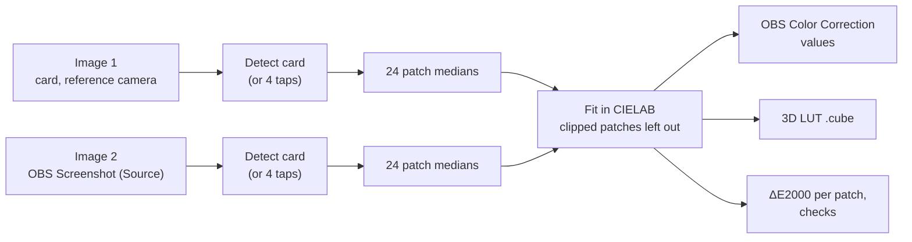

# obscolor

Browser tool that matches an OBS video source to a reference photo. Photo 1 shows a 24-patch ColorChecker under the scene's light, taken with the camera whose rendering you like. Photo 2 is an OBS screenshot of the video source showing the same card. The page finds the 24 patches in both images and fits the correction from the video back to the reference, as values for **OBS › Filters › Color Correction** and as a **3D LUT** (`.cube`) for **OBS › Filters › Apply LUT**.

Everything is computed in the browser. No photo is uploaded. The optional server function stores only the 24 measured patch colours.

## Use

Open `obscolor.html` in a current browser. Calculation works directly from disk (`file://`); only "Save to server" and "Load from server" need a PHP server (see below).

1. **Image 1, card direct**: choose or drop the reference photo. The card is detected and the 24 sampled areas are outlined in red.
2. **Image 2, OBS screenshot**: in OBS, switch the correction filter off, right-click the video source › Screenshot (Source), and choose or drop that file.
3. **Calculate**. Optionally **Fit Hue Shift too**, and choose the LUT size (17, 33 or 65).
4. Enter the Color Correction values in OBS (**Copy values** copies them as text), or download the LUT and load it with Apply LUT. Use one or the other, not both.
5. Check: switch the filter on, take a new screenshot, calculate again with it as image 2. The ΔE must drop.

**Load example** fills both boxes with a chart photo and a synthetically distorted copy (gamma, gain, offset, channel cross-talk, tilt) and runs the calculation.

## Method



**Detection.** Images are reduced to at most 1600 px on the longer side. Square, evenly filled bright components are found at several thresholds (Otsu and fixed levels); 18 to 24 of them are assigned to a 6 × 4 grid along the principal axes, and a homography is fitted with outlier removal. Of the four possible orientations, the one where the bottom row forms a monotone grey ramp and the blue, green and red patches carry their dominant channel is chosen. If detection fails or the overlay sits wrong, **Set corners by hand** and tap the centres of patches 1 (dark skin), 6 (bluish green), 24 (black) and 19 (white), in that order.

**Sampling.** Per channel median over a square at each patch centre, 40 % of the patch pitch wide. A patch whose 10th to 90th percentile spread exceeds 0.12 in any channel is flagged as uneven (glare, moiré, edge). Patches with any channel at or above 0.995 in either image are left out of the fit; at least 12 must remain.

**OBS Color Correction fit.** The filter is modelled as: gamma, then contrast, brightness, saturation (Rec.601 luma), hue shift, Color Multiply, Color Add, on gamma-encoded values. The parameters are fitted by bounded Levenberg–Marquardt on CIELAB differences to image 1 (three gamma start values; small penalties on contrast, brightness and Color Add), then rounded to steps of 0.01 (Hue Shift 0.1°, Multiply and Add 1/255). Hue Shift is fitted only when the option is on.

**LUT fit.** Per-channel power function, 3 × 3 matrix and offset, fitted the same way and written as a `.cube` file (`LUT_3D_SIZE` 17, 33 or 65, domain 0 to 1).

**Error.** CIEDE2000 between each corrected patch and image 1, before correction, with the rounded OBS values, and with the LUT; mean, median and maximum over the patches used in the fit. Below 1 is at the edge of visibility, above 3 clearly visible.

## Checks after Calculate

| Check                        | Trigger                                                      | Meaning                                                      |
| ---------------------------- | ------------------------------------------------------------ | ------------------------------------------------------------ |
| Grey tint                    | a* or b* range above 6 across the five lighter grey patches of image 1 | mixed light, clipping or tone curve; mid-tones and highlights get different corrections |
| Colour cast                  | mean a* or b* of those greys beyond ±6                       | the cast of image 1 is carried into the video                |
| Images do not match          | mean ΔE above 15 before correction                           | not the same card, place or light, or the overlay is misplaced |
| Poor fit                     | mean ΔE above 3 with the LUT                                 | images inconsistent; do not use the result                   |
| Filter too limited           | mean ΔE above 3 with the filter, LUT fine                    | use the LUT                                                  |
| Glare                        | 3 or more uneven patches in one image                        | tilt the card away from the light                            |
| White near clipping          | white patch of image 1 at 0.97 or above                      | expose slightly less                                         |
| Large Contrast or Brightness | \|Contrast\| above 0.5 or \|Brightness\| above 0.2           | often a Limited/Full range mismatch at the OBS source        |

The thresholds are rules of thumb, not standards.

## OBS settings before the screenshot

- **Source** (right-click › Properties): Color Space Rec.709 for HD webcams and HDMI capture; Color Range Limited for most devices, Full only if the device sends full range. These settings change the screenshot.
- **Camera automatics off**: auto white balance and auto exposure, otherwise the result holds for one moment only.
- **Output** (Settings › Advanced › Video): Color Format NV12, Color Space Rec.709, Color Range Limited. They do not affect the screenshot, but a mismatch makes the stream washed out or crushed.

Checking the source on the grey row of image 2:

- Washed out (black near RGB 16, white well below 255): limited signal decoded as full; set Color Range to Limited.
- Crushed blacks, clipped white: the reverse; set Color Range to Full.
- Primaries slightly off, mostly red and green: Rec.601/709 mix-up; set Color Space to Rec.709.

The screenshot holds the pixels OBS produces, before the monitor, so the monitor's colours do not enter the calculation.

## Output

| Button                   | File                | Content                                                      |
| ------------------------ | ------------------- | ------------------------------------------------------------ |
| Copy values              | clipboard           | Gamma, Contrast, Brightness, Saturation, Hue Shift, Opacity, Color Multiply and Color Add (hex and RGB), mean ΔE |
| Download LUT (.cube)     | `obs_colorcal.cube` | 3D LUT, screen to reference                                  |
| Download results (.json) | `obs_colorcal.json` | image names; per patch RGB of card and screen, ΔE uncorrected, filter and LUT, used in fit; clipped patches; OBS settings (Color Multiply and Color Add also as ABGR integers); parameter vectors; LUT model; ΔE statistics; warnings |

The page also shows the per-patch table and a comparison chart: each patch as card · screen · OBS filter · LUT.

## Two devices (optional server)

Each box has **Save to server** and **Load from server**. Saving stores the 24 measured patch values of that box (plus file name and status line), replacing what was stored before. Loading shows the 24 colours instead of a photo. Typical use: the phone takes image 1 and saves it; the computer running OBS takes the screenshot as image 2, loads box 1 from the server and calculates.

This needs `colorobs.php` next to the page on a PHP server. The page calls it as:

| Request                                     | Body                                                         | Answer (JSON)                                                |
| ------------------------------------------- | ------------------------------------------------------------ | ------------------------------------------------------------ |
| `POST colorobs.php?save=ref` or `?save=scr` | `{"v": 1, "rgb": [[r, g, b] × 24], "name": "...", "msg": "..."}` | `{"saved": "<ISO time>"}`                                    |
| `GET colorobs.php?load=ref` or `?load=scr`  |                                                              | `{"rgb": [...], "name": "...", "msg": "...", "saved": "<ISO time>"}` |

On error, the answer carries `{"error": "..."}` with a non-2xx status. Responses must be `application/json`.

Protect the folder with a password; otherwise anyone who reaches the page can overwrite the stored values.

Local test with the PHP built-in server:

```sh
php -S 127.0.0.1:8000
# open http://127.0.0.1:8000/obscolor.html
```

## Assumptions and limitations

- The Color Correction model follows the OBS filter as known to the author; it has not been re-checked against the current OBS source. Verify by applying the values and calculating again with a new screenshot. If the error does not drop, use the LUT.
- Color Multiply can only darken a channel. Where a channel needs more gain, the fit raises Contrast instead.
- The target is image 1, the reference camera's rendering of the card, not the card's measured reference colours. A warm scene stays warm.
- Browsers convert iPhone photos (Display P3) to sRGB; very saturated patches can clip in that conversion.
- A photo of the screen instead of an OBS screenshot also works, but the camera then adapts white balance and tone mapping to the screen, which hides part of the difference.
- The LUT model (power, 3 × 3 matrix, offset) is global; it cannot correct hue-specific errors that a fully sampled LUT could.

## Files

```
obscolor.html   the tool: detection, sampling, fitting, LUT export (HTML, CSS, JavaScript, example images)
colorobs.php    optional server endpoint for "Save/Load from server" (not in this repository yet)
```

The detection and fitting code (`window.ColorCal`) also loads in Node (`module.exports`) when extracted from the page.

## License

CC BY-NC 4.0, see [LICENSE](LICENSE).

## Author

Matthias Wjst, [wjst.de](https://www.wjst.de)
